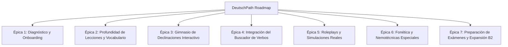

# 📋 Backlog de Producto y Calidad Pedagógica: DeutschPath / DeutschMeister

> **Visión**: Crear la plataforma web definitiva de aprendizaje de alemán para hispanohablantes, combinando la **gamificación táctil y adictiva de Duolingo** (botones 3D, rachas, feedback sonoro, XP, Word Tiles) con el **rigor conceptual de Babbel** (fórmulas sintácticas, matrices de casos, explicaciones gramaticales contrastadas y preparación para exámenes oficiales MCER Goethe/telc).

---

## 🚦 Matriz de Prioridades

- **🔴 P0 (Crítico / Inmediato)**: Carencias funcionales que frenan la experiencia de aprendizaje o el andamiaje didáctico básico.
- **🟡 P1 (Alta / Siguiente Sprint)**: Herramientas interactivas clave que elevan la retención y la autonomía del estudiante.
- **🟢 P2 (Medio Plazo / Diferenciadores)**: Simuladores avanzados, preparación formal de exámenes y módulos fonéticos.
- **⚪ P3 (Futuro / Nice to have)**: PWA, sincronización remota y expansión a B2/C1.

---

## 🗺️ Mapa de Épicas

---

## 🔴 P0 — Crítico e Inmediato

### [EP1-01] Test de Diagnóstico Rápido de Nivel (*Schnelltest*)
- **Área**: Onboarding / UX
- **Nivel**: Global (A1 / A2 / B1)
- **Problema actual**: El alumno nuevo entra a la web y no sabe si empezar en A1, A2 o B1, ni en qué estación concreta situarse.
- **Descripción**: Modal interactivo accesible desde la cabecera ("¿Cuál es mi nivel? 🎯") con un test adaptativo de 5 preguntas rápidas:
  1. Pregunta 1 (A1 básico): Saludo y regla V2 (*Heute ___ ich in Berlin*).
  2. Pregunta 2 (A1 intermedio): Acusativo masculino (*Ich habe ___ Hund*).
  3. Pregunta 3 (A2 inicial): Subordinada con *weil* (posición final del verbo).
  4. Pregunta 4 (A2 consolidado): *Wechselpräpositionen* (contraste Wo? vs Wohin?).
  5. Pregunta 5 (B1): Pasiva con *werden* o cláusula de infinitivo con *zu*.
- **Criterio de Aceptación (DoD)**:
  - Al terminar, muestra el nivel recomendado y desbloquea/posiciona automáticamente al alumno en la estación óptima.
  - Ofrece botón de "Aceptar sugerencia" o "Explorar por mi cuenta".

---

### [EP2-01] Ampliación del Andamio de Práctica (Paso 3 de cada Estación)
- **Área**: Didáctica / Contenidos
- **Nivel**: A1, A2, B1
- **Problema actual**: Cada estación cuenta únicamente con **1 ejercicio** en la fase de Práctica antes de saltar directamente al examen final.
- **Descripción**: Ampliar el array `practice` de cada unidad de A1, A2 y B1 para que contenga **3 a 4 ejercicios progresivos**:
  - Ejercicio 1: Reconocimiento básico de la regla.
  - Ejercicio 2: Selección entre distractores típicos de hispanohablantes.
  - Ejercicio 3: Transformación o aplicación en frase completa.
- **Criterio de Aceptación (DoD)**:
  - Todas las estaciones de A1, A2 y B1 tienen al menos 3 ejercicios interactivos con su explicación pedagógica `why`.
  - El botón "Continuar al Examen" solo se desbloquea tras responder todos los micro-retos.

---

### [EP4-01] Integración del Buscador y Conjugador de Verbos (`verbs.json`)
- **Área**: Herramientas / UI
- **Nivel**: Global (A1, A2, B1)
- **Problema actual**: Existe una excelente base de datos de verbos fundamentales (`data/verbs.json`) con más de 50 verbos conjugados, casos que rigen y auxiliares (*sein* vs *haben*), pero aún no está visible en la interfaz.
- **Descripción**: Añadir una pestaña o modal **"Diccionario de Verbos"** (📚 *Verbliste*):
  - Buscador en tiempo real por infinitivo en alemán o traducción en español.
  - Filtros rápidos por cápsulas: Nivel (A1 / A2 / B1), Auxiliar (*ist* vs *hat*), Tipo (Irregulares / Modales / Separables) y Caso que rigen (Akkusativ / Dativ).
  - Tarjeta de detalle con: Presente, Präteritum, Partizip II, auxiliar, ejemplo de uso bilingüe y botón de pronunciación con audio nativo.
- **Criterio de Aceptación (DoD)**:
  - El usuario puede consultar cualquier verbo en menos de 2 segundos desde cualquier parte de la lección sin perder su progreso.

---

## 🟡 P1 — Alta Prioridad (Siguiente Sprint)

### [EP3-01] Gimnasio de Declinaciones Interactivo (*Deklinations-Trainer*)
- **Área**: Gramática Interactiva
- **Nivel**: A1, A2, B1
- **Problema actual**: La pestaña de casos del cuaderno muestra matrices y tablas estáticas, sin oportunidad de entrenar activamente.
- **Descripción**: Modo de juego interactivo de respuesta rápida ("El Duelo de Artículos"):
  - Se presenta una frase con un hueco: *"Ich gebe ___ Kind einen Apfel."*
  - El alumno ve 4 pastillas 3D: `der`, `die`, `dem`, `den`.
  - Al pulsar, recibe feedback inmediato con la explicación del porqué (*"geben exige Dativo; das Kind en Dativo se convierte en dem"*).
  - Contador de aciertos seguidos (*Combo streak*) y bonificación de XP.
- **Criterio de Aceptación (DoD)**:
  - Banco de al menos 30 frases distribuidas en Nominativ, Akkusativ, Dativ y Genitiv.
  - Filtro para practicar: "Solo Acusativo vs Dativo", "Las 9 Wechselpräpositionen" o "Genitivo B1".

---

### [EP2-02] Expansión Léxica y Modo Flashcards con Audio
- **Área**: Vocabulario / Retención
- **Nivel**: A1, A2, B1
- **Problema actual**: 4 palabras por unidad es un número reducido frente al estándar del MCER (600 palabras en A1, 1.200 en A2).
- **Descripción**:
  - Ampliar a 8–10 términos clave por estación en los JSON.
  - Implementar en el paso 2 de cada lección un conmutador: **"Modo Tarjetas"** (Flippable Flashcards) y **"Modo Lista Rápida"**.
  - Código de colores visual innegociable:
    - Azul para masculinos (`der`).
    - Rojo para femeninos (`die`).
    - Verde para neutros (`das`).
    - Amarillo para plurales.
- **Criterio de Aceptación (DoD)**:
  - 100% de sustantivos mostrados con su artículo, plural y audio funcional.

---

### [EP5-01] Simulador de Diálogos y Roleplays Guiados (*Rollenspiel Trainer*)
- **Área**: Expresión Oral / Diálogos
- **Nivel**: A1, A2, B1
- **Problema actual**: La pestaña de supervivencia solo tiene 1 pregunta interactiva aislada en una cafetería.
- **Descripción**: Crear 4 escenarios interactivos ramificados por turnos estilo chat:
  1. *Beim Bäcker* (Comprar panecillos y pedir precio).
  2. *Am Bahnhof* (Comprar billete de tren, preguntar por andén y retrasos).
  3. *Beim Arzt* (Describir dolor, pedir cita y receta en la farmacia).
  4. *Im Vorstellungsgespräch* (Presentación profesional formal para B1).
  - El interlocutor virtual habla (audio en alemán) y el alumno elige entre 3 respuestas posibles (1 adecuada, 1 demasiado informal, 1 gramaticalmente incorrecta).
- **Criterio de Aceptación (DoD)**:
  - Cada diálogo tiene entre 3 y 5 intercambios comunicativos con puntuación final y feedback del profesor.

---

## 🟢 P2 — Medio Plazo (Diferenciadores Pedagógicos)

### [EP6-01] Entrenador de Fonética y Pronunciación para Hispanohablantes
- **Área**: Fonética / Audio
- **Nivel**: A1 - B1
- **Descripción**: Módulo dedicado a desmitificar los sonidos del alemán que no existen en español:
  - La diéresis: Contraste de vocales `u` vs `ü`, `o` vs `ö`, `a` vs `ä`.
  - La consonante `z` como [ts] (*Zug, Zeit, zusammen*).
  - La `v` que suena a [f] (*Vogel, viel*) vs la `w` que suena a [v] (*Wasser, wohnen*).
  - El sonido de la `ch`: *ich-Laut* (suave tras e/i/ä/ö/ü) vs *ach-Laut* (fuerte tras a/o/u).
  - Ejemplos audibles comparativos y trucos musculares de articulación ("Pon boca de 'U' y di 'I' para decir 'Ü'").
- **Criterio de Aceptación (DoD)**:
  - Sección interactiva en el cuaderno de gramática con reproducción de audio para cada pareja mínima contrastada.

---

### [EP6-02] Píldoras Nemotécnicas: La Regla TE-KA-MO-LO y Falsos Amigos
- **Área**: Gramática / Estilística
- **Nivel**: A2 - B1
- **Descripción**:
  - **TE-KA-MO-LO Trainer**: Visualizador interactivo que permite al alumno arrastrar complementos para ordenar la frase en el orden canónico alemán: **TE**mporal -> **KA**usal -> **MO**dal -> **LO**kal.
  - **Muro de Falsos Amigos (*Falsche Freunde*)**: Tarjetas interactivas con trampas clásicas (*bekommen* = recibir, no llegar a ser; *also* = por tanto, no también; *der Chef* = jefe, no cocinero; *die Hochschule* = universidad, no escuela secundaria).
- **Criterio de Aceptación (DoD)**:
  - Retos específicos de Word Tiles donde se ponga a prueba el orden TE-KA-MO-LO.

---

### [EP7-01] Taller de Redacción y Expresión Escrita B1 (*Schreib-Werkstatt*)
- **Área**: Preparación de Exámenes (Goethe / telc)
- **Nivel**: B1
- **Descripción**: Plantillas y estructuras estándar para la prueba escrita de B1:
  - Cómo empezar y despedir una carta/email formal (*Sehr geehrte Damen und Herren... Mit freundlichen Grüßen*) vs informal (*Liebe Maria... Viele Grüße*).
  - Conectores de argumentación: *Einerseits... andererseits*, *Meiner Meinung nach*, *Aus diesem Grund*.
  - Ejercicios interactivos de rellenar conectores en modelos reales de cartas de reclamación o solicitud de información.
- **Criterio de Aceptación (DoD)**:
  - 3 modelos completos de redacción interactiva con checklist de autoevaluación.

---

## ⚪ P3 — Futuro y Arquitectura Técnica

### [EP8-01] Soporte PWA y Modo Offline Completo
- **Área**: Infraestructura Web
- **Descripción**: Configuración de `manifest.json` y Service Worker para instalar la plataforma como aplicación de escritorio o móvil (iOS/Android) con precacheo de audios y currículos JSON para estudiar en el avión o metro sin conexión.

### [EP8-02] Expansión a Nivel B2 (Competencia Operativa y Fluidez)
- **Área**: Contenidos Curriculares
- **Descripción**: Creación de `data/b2.json` con las 10 estaciones oficiales de B2: conectores dobles (*je... desto*, *nicht nur... sondern auch*), estilo indirecto con *Konjunktiv I*, participios atributivos ampliados y combinaciones verbo-nombre (*Nomen-Verb-Verbindungen*).

---

## 📊 Resumen Ejecutivo del Backlog

| Épica / Item | Título | Nivel | Prioridad | Esfuerzo | Impacto Alumno |
| :--- | :--- | :---: | :---: | :---: | :---: |
| **EP1-01** | Schnelltest (Test diagnóstico de nivel) | Global | 🔴 P0 | Bajo | 🔥🔥🔥 Muy Alto |
| **EP2-01** | Ampliación de Práctica (3-4 micro-retos/unidad) | A1-B1 | 🔴 P0 | Medio | 🔥🔥🔥 Muy Alto |
| **EP4-01** | Buscador y Conjugador de Verbos (`verbs.json`) | Global | 🔴 P0 | Medio | 🔥🔥🔥 Muy Alto |
| **EP3-01** | Gimnasio de Declinaciones Interactivo | A1-B1 | 🟡 P1 | Medio | 🔥🔥🔥 Muy Alto |
| **EP2-02** | Expansión de Vocabulario & Flashcards con color | A1-B1 | 🟡 P1 | Medio | 🔥🔥 Alto |
| **EP5-01** | Roleplay Trainer (4 diálogos ramificados) | A1-B1 | 🟡 P1 | Alto | 🔥🔥 Alto |
| **EP6-01** | Entrenador de Fonética y Parejas Mínimas | A1-B1 | 🟢 P2 | Bajo | 🔥🔥 Alto |
| **EP6-02** | TE-KA-MO-LO y Falsos Amigos | A2-B1 | 🟢 P2 | Bajo | 🔥 Medio |
| **EP7-01** | Taller de Redacción B1 (Cartas e Emails) | B1 | 🟢 P2 | Medio | 🔥🔥 Alto |
| **EP8-01** | PWA & Offline Service Worker | Global | ⚪ P3 | Medio | 🔥 Medio |
| **EP8-02** | Creación del Nivel B2 Oficial | B2 | ⚪ P3 | Alto | 🔥🔥 Alto |

---
*Documento vivo mantenido por el equipo didáctico de DeutschMeister.*
